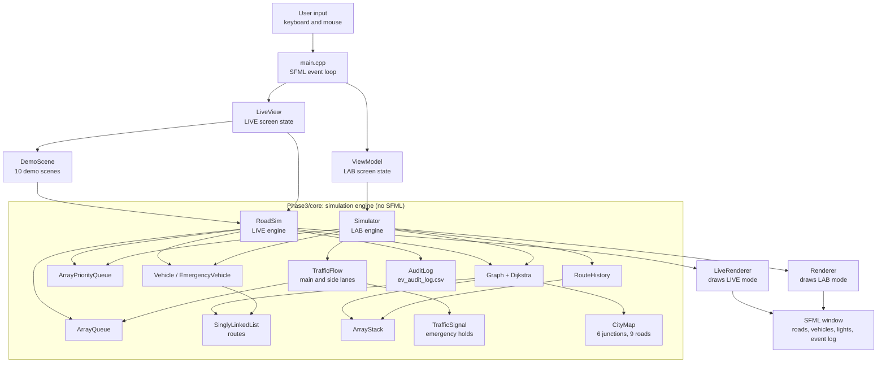
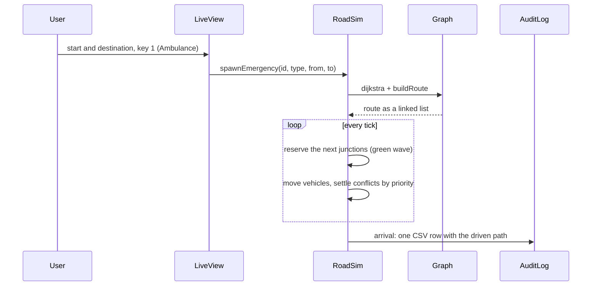

# Adaptive Traffic Signal & Emergency Vehicle Simulator

**A C++17 traffic simulator in which ambulances, fire trucks and police cars find the fastest route, clear their path through traffic, and resolve conflicts at junctions, built on our own data structures and shown in a real-time SFML window.**

> https://github.com/user-attachments/assets/b2313aa2-f5ce-4966-a692-144030a0c7f6

<p>

</p>

<div align="center"><a href="https://skillicons.dev"></a>&nbsp;&nbsp;
</div>

---

## Table of Contents

1. [Project Introduction](#project-introduction)
2. [What Makes This Project Different?](#what-makes-this-project-different)
3. [Development Journey (Phase 1, 2 and 3)](#development-journey-phase-1-2-and-3)
4. [Technology Stack](#technology-stack)
5. [System Architecture](#system-architecture)
6. [Folder Structure](#folder-structure)
7. [Module Connections](#module-connections)
8. [How to Run](#how-to-run)
9. [Testing and Future Improvements](#testing-and-future-improvements)
10. [Team](#team)

---

## Project Introduction

Every minute matters for an ambulance, yet at a busy junction it is treated like any other vehicle: it waits in the same queue, stops at the same red light, and is blocked by the same traffic. Ordinary signals and queues have no idea that one vehicle is more urgent than another.

This project simulates a small city of **6 junctions and 9 two-way roads** and asks a simple question: *what would a traffic system need in order to give emergency vehicles a real advantage?* The simulator answers it with working mechanisms:

- **Routing:** each emergency vehicle gets the shortest route from **Dijkstra's algorithm** on a weighted road graph, and is rerouted automatically when a road closes.
- **Priority:** when emergency vehicles compete for the same junction, a **priority queue** decides who goes first: Ambulance before Fire Truck before Police, and the earlier arrival on a tie.
- **Clearing the way:** junctions ahead of an emergency vehicle are reserved before it arrives (a **green wave**), and normal vehicles move to the shoulders so it can drive down the centre.
- **Signals:** an optional **adaptive signal mode** gives green to the busiest road, for longer when the road is denser.
- **Accountability:** every emergency trip is written to a **CSV audit log**.

It is an educational simulation of these ideas, not a system connected to real traffic infrastructure.

---

## What Makes This Project Different?

Many traffic simulators either use ready-made containers or animate vehicles without real algorithms underneath. This project combines **hand-written data structures, graph routing, priority rules and step-by-step vehicle movement** in one system, with automated tests that check the engine after every simulation step.

| Feature | What it does | Why it matters |
|---|---|---|
| **Custom data structures** | Queue, priority queue, stack, singly linked list and graph are written by the team. The core and the window use **no STL containers**. | Every algorithm is visible and explainable, from queue operations to route reconstruction. |
| **Graph-based emergency routing** | Roads form a weighted adjacency-list graph; Dijkstra finds the shortest route; a stack reverses the path into a linked-list route. | Emergency vehicles take the fastest available path instead of a fixed one. |
| **Priority-based emergency handling** | Lower priority number goes first (1 Ambulance, 2 Fire Truck, 3 Police); equal priorities are decided by arrival time. | Conflicts at junctions are resolved by one consistent rule, so two emergency vehicles can never block each other forever. |
| **Green-wave preemption** | Each emergency vehicle reserves the next two junctions on its route; normal vehicles may not enter a reserved junction. | Cross-traffic is stopped *before* the emergency vehicle arrives, not after. |
| **Centre-overtake** | Normal vehicles on a road with an emergency vehicle move to the shoulders; the emergency vehicle uses the cleared centre lane. | The emergency vehicle keeps moving even through a jammed road. |
| **Road closure and rerouting** | Roads can be closed and reopened while the simulation runs; affected vehicles re-plan with Dijkstra. Vehicles with no route left are stopped safely. | Shows how routing reacts to a changing network, including the failure case. |
| **Adaptive traffic signals** | Optional mode (key **G**): the busiest approach gets green for 4, 8 or 12 ticks at LOW, MODERATE or HEAVY density; a vehicle waiting 40 ticks is served next. Lights beside the roads show which approach has green. | Signal timing responds to traffic, without starving quiet roads. |
| **Multiple emergency vehicles** | Up to 8 emergency vehicles at once in LIVE mode, with ten repeatable demo scenes. | Tie-breaking, head-on passing and junction conflicts can be shown on demand. |
| **LIVE and LAB modes** | Two engines on the same map: LIVE shows every vehicle driving; LAB shows dispatch junction by junction. | The same rules can be watched at two levels of detail. |
| **Self-checking engine and tests** | `selfCheck()` validates the internal state; ten test programs run with CTest, including memory stress tests that count every `new` and `delete`. | Bugs such as vehicles overlapping or memory leaks are caught automatically. |
| **Audit logging** | Every finished emergency trip becomes one row in `ev_audit_log.csv`, including the path actually driven. | Trips can be reviewed after the run, including detours. |


<p align="center">
  
</p>

---

## Development Journey (Phase 1, 2 and 3)

The project was built in three phases. Each phase **builds on the previous one** instead of replacing it: the Phase 1 data structures are still the ones used by the Phase 3 engines.

### Phase 1 — Data Structures and OOP Foundation

The original Phase 1 files are kept in `Phase1/` with the prefix `Phase1_<filename>` (for example `Phase1_main.cpp`), so they are clearly separate from later versions.

| Component | Role |
|---|---|
| `ArrayQueue` | First-in, first-out line of vehicles waiting at a junction. |
| `ArrayPriorityQueue` | Picks the most urgent emergency request (priority first, then arrival time). |
| `ArrayStack` | Last-in, first-out storage, later used for route history and route reversal. |
| `SinglyLinkedList` | Stores a vehicle's route as a chain of junctions. |
| `Vehicle`, `EmergencyVehicle` | Classes using encapsulation and inheritance (defined in `Phase1_main.cpp`). |
| `Junction`, `EmergencyRequest` | Structures describing the 6 junctions and emergency requests. |

`Phase1_main.cpp` integrates these into a first console simulation of junctions, normal vehicles and emergency requests.

### Phase 2 — Graph Integration and Traffic Logic

Phase 2 turns the separate structures into a routing and traffic system (console program in `Phase2/`):

- **Graph:** a weighted road network stored as an adjacency list, with **BFS** and **DFS** to check that every junction is reachable.
- **Dijkstra's algorithm:** finds the shortest route. The result is reversed with the **stack** and stored in a **singly linked list** inside the vehicle.
- **TrafficFlow:** a queue at every junction, vehicle arrival, departure and movement, and **density levels**: LOW (0–2 vehicles), MODERATE (3–5) and HEAVY (6 or more).
- **Emergency handling:** the priority queue selects the next request, and the emergency vehicle **skips the waiting queue** at each junction.
- **RouteHistory:** records every junction reached, using the stack, and supports backtracking.
- **OOP improvements:** virtual functions and a virtual destructor, so one loop over `Vehicle*` handles both vehicle types correctly.
- **Tests:** `test_graph`, `test_traffic` and `test_history`.

### Phase 3 — Real-Time Simulation and SFML Visualization

Phase 3 turns the console program into a real-time simulation with a graphical window. The code is split into an **engine** (`Phase3/core/`) and a **window** (`Phase3/SFML/`), and the engine never includes SFML.

- **Simulator (LAB mode):** dispatches the most urgent emergency request, preempts the signal at the next junction, moves waiting vehicles into a side lane, restores them afterwards, and reroutes around closed roads. Includes lane-availability checks, vehicle-ID checks, trip completion and reset.
- **RoadSim (LIVE mode):** every vehicle drives along the roads cell by cell. Each tick runs fixed phases: junction exits, junction entries, lane movement, spawning from waiting lines, and wait timeouts (a normal vehicle stuck for 300 ticks gives up, so the simulation never locks). It handles the green wave, centre-overtake, emergency conflicts, rerouting and statistics (arrivals, conflicts, tie-breaks, reroutes and more).
- **TrafficSignal:** new in Phase 3. A per-junction emergency hold counter, so one vehicle releasing a junction cannot cancel another vehicle's hold.
- **Adaptive traffic signals:** density-based green times in LIVE mode, switchable at run time.
- **AuditLog:** CSV record of every completed emergency trip.
- **CityMap:** the 6 junctions and 9 roads are defined once in `CityMap.hpp` and shared by both engines, the renderer and the tests.
- **Memory management:** vehicles are created with `new` and deleted on arrival or reset; copying is disabled for classes that own memory.
- **Internal state validation:** `selfCheck()` in both engines checks vehicle positions, IDs, lane contents, reservations and counters.
- **DemoScene:** ten repeatable scenes on seeded background traffic.
- **SFML interface:** LIVE and LAB views, menus, an event log, and a mode switch with **Tab**.
- **Build and tests:** CMake builds the engine as a static library and registers ten test programs with CTest.

**Status:** all three phases are complete. The project builds on Windows with MinGW and SFML 2.6.2, and all ten test programs pass with CTest.

---

## Technology Stack

| Technology | Use |
|---|---|
| [C++17](https://isocpp.org/) | Language. Object-oriented design with inheritance and virtual functions. |
| Custom data structures | Queue, priority queue, stack, singly linked list, graph (no STL containers in the engine or window). |
| C++ standard library | `iostream`, `string`, `fstream` (audit log), `cmath` (drawing). |
| [SFML 2.x](https://www.sfml-dev.org/) | Window, input and drawing (modules: graphics, window, system). Used by the window only. |
| [CMake](https://cmake.org/) 3.16+ | Build system; CTest runs the tests. |
| MinGW-w64 g++ | Compiler used for the Windows build. |
| [Git](https://git-scm.com/) and GitHub | Version control and collaboration. |

---

## System Architecture

The engine (`Phase3/core/`) is independent of the window. The window (`Phase3/SFML/`) only reads from and sends commands to the two engines. This is why every engine rule can be tested without opening a window.



| Layer | Responsibility |
|---|---|
| **Input** (`main.cpp`) | Reads keyboard and mouse events, switches between LIVE and LAB, and passes each action to the right view. |
| **Screen state** (`LiveView`, `ViewModel`) | Remembers selections, menus and animation timing, and calls the engines. Contains no drawing code, so it is tested without a window. |
| **Engines** (`RoadSim`, `Simulator`) | Hold all simulation rules. They do not know that a window exists. |
| **Data structures** | The Phase 1 and Phase 2 structures, used by both engines. |
| **Drawing** (`LiveRenderer`, `Renderer`) | Read the engine state every frame and draw it with SFML. |

---

## Folder Structure

```text
Adaptive-Traffic-Simulator/
├── README.md
├── .gitignore
├── Phase1/                         original Phase 1 code (Phase1_ prefix)
│   ├── Phase1_main.cpp
│   ├── Phase1_ArrayQueue.hpp
│   ├── Phase1_ArrayPriorityQueue.hpp
│   ├── Phase1_ArrayStack.hpp
│   ├── Phase1_SinglyLinkedList.hpp
│   └── Phase1_README.md
├── Phase2/                         console simulator with graph routing
│   ├── main.cpp
│   ├── include/
│   │   ├── ArrayQueue.hpp, ArrayPriorityQueue.hpp, ArrayStack.hpp, SinglyLinkedList.hpp
│   │   ├── Graph.hpp, TrafficFlow.hpp, RouteHistory.hpp
│   │   └── Vehicle.hpp, EmergencyVehicle.hpp, EmergencyRequest.hpp
│   └── tests/
│       └── test_graph.cpp, test_traffic.cpp, test_history.cpp
└── Phase3/
    ├── core/                       simulation engine (no SFML)
    │   ├── include/
    │   │   ├── CityMap.hpp                     the 6-junction map
    │   │   ├── Simulator.hpp, RoadSim.hpp      the two engines
    │   │   ├── DemoScene.hpp                   demo scenes
    │   │   ├── AuditLog.hpp                    CSV audit log
    │   │   ├── Graph.hpp, TrafficFlow.hpp, TrafficSignal.hpp, RouteHistory.hpp
    │   │   ├── ArrayQueue.hpp, ArrayPriorityQueue.hpp, ArrayStack.hpp, SinglyLinkedList.hpp
    │   │   └── Vehicle.hpp, EmergencyVehicle.hpp, EmergencyRequest.hpp
    │   └── src/                    function bodies of the modules above
    └── SFML/                       window, build and tests
        ├── main.cpp                event loop, keys, LIVE/LAB switch
        ├── CMakeLists.txt
        ├── include/
        │   └── LiveView.hpp, LiveRenderer.hpp, ViewModel.hpp, Renderer.hpp
        ├── src/
        │   └── LiveView.cpp, LiveRenderer.cpp, ViewModel.cpp, Renderer.cpp
        └── tests/
            ├── MemTracker.hpp      counts every new and delete
            └── test_*.cpp          10 test programs
```

| Directory | Purpose |
|---|---|
| `Phase1/` | Original data structures and OOP foundation, kept for reference |
| `Phase2/` | Console simulator with graph routing, traffic flow and route history |
| `Phase3/core/include/` | Declarations of the engine modules and the shared map |
| `Phase3/core/src/` | Implementations of the engine modules (built as the `traffic_core` library) |
| `Phase3/SFML/include/` | Screen-state and drawing classes for the window |
| `Phase3/SFML/src/` | Their implementations |
| `Phase3/SFML/tests/` | Ten automated test programs and the allocation counter |

---

## Module Connections

**Vehicle system.** `Vehicle` stores an ID and its route (a `SinglyLinkedList` of junctions). `EmergencyVehicle` inherits from it, adds a priority (1 Ambulance, 2 Fire Truck, 3 Police) and overrides virtual functions, so code working with `Vehicle*` treats each type correctly.

**Queue system.** `ArrayQueue` is the waiting line. In LAB mode, `TrafficFlow` keeps a main lane and a side lane per junction. In LIVE mode, `RoadSim` keeps a spawn queue per junction for vehicles waiting to enter the road.

**Priority queue.** `ArrayPriorityQueue` holds emergency requests and always returns the most urgent: lowest priority number first, earliest arrival on a tie. LAB mode uses it to choose the next dispatch. LIVE mode uses the same order when emergency vehicles meet at a junction.

**Graph and Dijkstra.** `Graph` stores the roads as an adjacency list built from `CityMap.hpp`. `dijkstra()` computes the shortest distances; `buildRoute()` follows the path backwards, pushes it onto an `ArrayStack`, and pops it into the vehicle's linked-list route in the correct order.

**RouteHistory.** Built on `ArrayStack`, it records each junction the LAB emergency vehicle reaches and supports backtracking.

**TrafficFlow and TrafficSignal.** In LAB mode, before an emergency vehicle moves, the next junction is either **bypassed** (nobody waiting) or **preempted**: its `TrafficSignal` turns green for the emergency vehicle, and waiting vehicles move to the side lane. When the vehicle leaves, the signal is released and the vehicles return in the same order.

**Simulator and RoadSim.** The two engines share the map, the data structures and the priority rules, but model traffic at different levels:

| | Simulator (LAB) | RoadSim (LIVE) |
|---|---|---|
| Movement | Junction to junction, one step per action | Cell by cell along the roads, every tick |
| Emergency vehicles | One dispatched trip at a time | Up to 8 at once |
| Clearing traffic | Signal preemption and side-lane evacuation | Green wave and centre-overtake |
| Signals | `TrafficSignal` hold counters | Junction reservations; optional adaptive signals |
| Extras | Route history | Audit log, statistics, demo scenes |

**SFML interface.** Each frame, the views update their animation from the engine state and the renderers draw it. Keys and mouse clicks become calls such as `spawnEmergency`, `closeRoad` or `setAdaptiveSignals`.

**AuditLog.** When an emergency vehicle arrives in LIVE mode, `RoadSim` appends one row to `ev_audit_log.csv`:

```text
tick,vehicle_id,priority,start,destination,path,Time Taken (Ticks)
18,901,1,J1,J6,J1->J2->J4->J6,18
```

The `path` column records the junctions actually crossed, so detours appear exactly as driven. If the file cannot be written, the error is reported and the simulation continues.



---

## How to Run

### Prerequisites

| Tool | Version |
|---|---|
| Git | any recent version |
| C++ compiler | with C++17 support (the team uses MinGW-w64 g++ on Windows) |
| CMake | 3.16 or newer |
| SFML | 2.5 or newer in the 2.x series (tested with SFML 2.6.2), modules graphics, window and system |

### 1. Clone the repository

```bash
git clone https://github.com/Shivansh-Upreti/Adaptive-Traffic-Simulator.git
cd Adaptive-Traffic-Simulator
```

### 2. Configure

The Phase 3 build lives in `Phase3/SFML`:

```bash
cd Phase3/SFML
cmake -S . -B build
```

On **Windows with MinGW**, tell CMake where SFML is installed. Change the path to match your own installation:

```bash
cmake -S . -B build -G "MinGW Makefiles" -DSFML_DIR=C:/SFML-2.6.2/lib/cmake/SFML
```

`SFML_DIR` is the folder that contains `SFMLConfig.cmake`. If SFML is installed at `C:/SFML-2.6.2`, the project finds it even without this option.

### 3. Build

```bash
cmake --build build
```

This builds the engine library `traffic_core`, the window program `traffic_sfml`, and the ten test programs. On Windows, the build copies the three SFML DLLs (`sfml-graphics-2`, `sfml-window-2`, `sfml-system-2`) next to the program, because Windows needs them in the same folder to start it.

### 4. Run the simulator

Windows:

```bash
./build/traffic_sfml.exe
```

Linux / macOS:

```bash
./build/traffic_sfml
```

The team builds and tests on Windows. On Linux or macOS, install the SFML 2.x development package so that CMake can find it; the same steps should apply, but they have not been tested by the team.

### 5. Run the tests

```bash
ctest --test-dir build --output-on-failure
```

CTest runs all ten test programs and reports each as Passed or Failed. `--output-on-failure` prints the full output of any failing test, showing which check failed. A complete success ends with:

```text
100% tests passed, 0 tests failed out of 10
```

The tests need no window and no display.

### Earlier phases (optional)

Phase 2 is a console program:

```bash
cd Phase2
g++ -std=c++17 main.cpp -o traffic_sim
./traffic_sim
```

Phase 1 is kept as a reference copy. Its files carry the `Phase1_` prefix, so remove the prefix from the header files before compiling `Phase1_main.cpp`.

### Controls and Simulation Modes

<p align="center">
  
</p>

The window opens in **LIVE mode**. **Tab** switches between LIVE and LAB. Both modes use the mouse to select junctions:

| Mouse | Action |
|---|---|
| Left click on a junction | Select the **start** junction |
| Right click on a junction | Select the **destination** junction |

#### LIVE mode (RoadSim)

| Key | Action |
|---|---|
| **U** | Open User Defined Input mode (see below) |
| **D** | Open the demo scene menu, then **1–9** or **0** (scene 10) |
| **G** | Switch adaptive traffic signals on or off |
| **K** | Run the engine self-check |
| **Space** or **T** | Pause / resume |
| **+** / **−** | Faster / slower |
| **R** | Reset: remove every vehicle and empty `ev_audit_log.csv` |
| **Tab** | Switch to LAB mode |
| **Esc** | Close a menu / quit |

**User Defined Input mode (U):**

| Key | Action |
|---|---|
| **1** | Spawn a single vehicle: select start and destination, then press **1** Ambulance, **2** Fire Truck, **3** Police, **9** normal vehicle, or **0** opposing traffic |
| **2** | Batch spawn: select start and destination to create 5 normal vehicles |
| **3** | Toggle road closure: left-click one junction, right-click the other to close or reopen the road between them |
| **4** | Heavy background traffic on / off |
| **Esc** | Back |

#### LAB mode (Simulator)

| Key | Action |
|---|---|
| **N** | Add a normal vehicle at the start junction |
| **1** / **2** / **3** | Create an Ambulance / Fire Truck / Police request from start to destination |
| **Space** | Dispatch the most urgent request |
| **M** | Move a normal vehicle from start to destination |
| **L** | A normal vehicle leaves at the start junction |
| **C** | Close or reopen the road between start and destination |
| **B** | Build a demo scene (8 normal vehicles and 3 emergency requests) |
| **K** | Run the engine self-check |
| **R** | Reset |
| **T** | Pause / resume |
| **+** / **−** | Faster / slower |
| **Tab** | Switch to LIVE mode |

### Demo Scenes

Press **D** in LIVE mode, then a number. Every scene starts with 40 ticks of seeded background traffic, so it plays out the same way every time. It ends by itself when its emergency vehicles are finished. The console prints the queue order and tie-break decisions as they happen.

| Key | Scene | What it shows |
|---|---|---|
| **1** | J4 convergence | Ambulance, Fire Truck and Police car reach J4 together and pass in priority order |
| **2** | Ambulance tie-breaker | Two priority-1 vehicles meet at J4; the earlier arrival goes first |
| **3** | Fire Truck tie-breaker | The same with two priority-2 vehicles |
| **4** | Police tie-breaker | The same with two priority-3 vehicles |
| **5** | Four-vehicle bottleneck | Two Ambulances, a Fire Truck and a Police car pass J4 in the correct order |
| **6** | Head-on road conflict | Two Ambulances on the same road in opposite directions pass each other on their own sides |
| **7** | Simultaneous arrival | Two Ambulances enter J4 from opposite sides in the same tick; arrival time decides |
| **8** | Road closed | The Ambulance's planned road J1–J2 closes; Dijkstra re-plans it to J1 → J3 → J4 → J6 |
| **9** | Gridlock | 20 vehicles jam J5 → J6; the Ambulance drives down the centre while they wait on the shoulders |
| **0** | No way through | All roads into J6 close mid-trip; the Ambulance is stopped safely at J2 with a `[STOPPED]` message |


<table>
  <tr>
    <td width="50%"></td>
    <td width="50%"></td>
  </tr>
  <tr>
    <td width="50%"></td>
    <td width="50%"></td>
  </tr>
</table>

Each scene is built by `buildMultiEVDemo()` in `DemoScene.cpp`, the same function the tests use, so the scenes on screen are the scenes that are tested.

---

## Testing and Future Improvements

### Testing and Validation

The ten test programs are in `Phase3/SFML/tests/` and are registered with CTest in `CMakeLists.txt`. Every test prints one line per check and a final `N passed, M failed` summary.

| Test program | What it validates |
|---|---|
| `test_graph` | Dijkstra distances, route order, invalid roads and junctions, unreachable junctions, BFS reach |
| `test_history` | Route history: empty, single junction, display without loss, backtracking |
| `test_traffic` | Junction queues, arrival, departure, movement, density levels, emergency skip, invalid inputs |
| `test_phase3` | LAB engine: priority order, empty-junction bypass, signal preemption, side-lane evacuation, rerouting, closed roads, self-check |
| `test_roadsim` | LIVE engine: movement, green wave, centre-overtake, conflicts, all ten demo scenes, audit log; self-check after every tick |
| `test_view` | LAB screen logic without a window |
| `test_liveview` | LIVE screen logic without a window, including multi-emergency tie-breaks |
| `test_stress` | Thousands of random (often invalid) LAB operations; self-check after each; counts every `new` and `delete` |
| `test_roadstress` | The same for the LIVE engine, and checks that traffic never locks up |
| `test_leaks` | Memory: after whole scenarios, every allocation has been freed (counted without external tools) |

**Current results:** all ten test programs pass with CTest on Windows (MinGW). The same tests (540 checks) also pass on Linux with g++ 13, with no compiler warnings.

**Not covered by automated tests:** the keyboard handling in `main.cpp` and the drawing code. These are checked by hand in the window.

### Known Limitations

- **Fixed map:** the network is fixed at 6 junctions and 9 roads (`CityMap.hpp`), and the window draws junctions at fixed positions. This keeps the project simple. Roads can still be closed and reopened while the simulation runs.
- **One trip at a time in LAB mode:** LAB dispatches one emergency trip at a time (LIVE handles up to 8 at once). Backtracking in LAB mode is manual.
- **Adaptive signals are optional:** in our runs, the default "longest wait first" rule gives slightly shorter average trips, because it can switch for every single vehicle at no cost, which a real signal cannot. Adaptive mode models realistic green phases instead.
- **Simplified time:** the simulation runs in ticks, not real seconds.

### Possible Future Improvements

These are ideas, not current features:

- Read the road network from a file, and support more junctions with an automatic screen layout.
- Compare adaptive signals against a fixed-time signal inside the simulator, with on-screen statistics.
- More detailed analytics, such as average emergency response time per scene, read from the audit log.
- Automated tests for the window's key handling.
- Automatic backtracking in LAB mode.

---

## Team

**Team CODEXIUM** — B.Tech CSE (AI & ML), Graphic Era Hill University, Dehradun

| Member | Main contributions |
|---|---|
| **Shivansh Upreti** (Team Lead) | Phase 1 singly linked list and vehicle classes; Phase 2 OOP and emergency logic; Phase 3 Simulator, RoadSim, SFML main program, audit log, adaptive signals, CityMap, demo scenes 8–10, CMake and tests; integration |
| **Sobit Saklani** | ArrayQueue; Phase 2 traffic flow and density; Phase 3 TrafficFlow, TrafficSignal, LiveView and LiveRenderer |
| **Ajay Kumar** | ArrayPriorityQueue; Phase 2 graph, BFS, DFS and Dijkstra; Phase 3 Graph updates, ViewModel and Renderer |
| **Pallavi Lingwal** | ArrayStack; Phase 2 RouteHistory and backtracking; Phase 3 RouteHistory and DemoScene |
